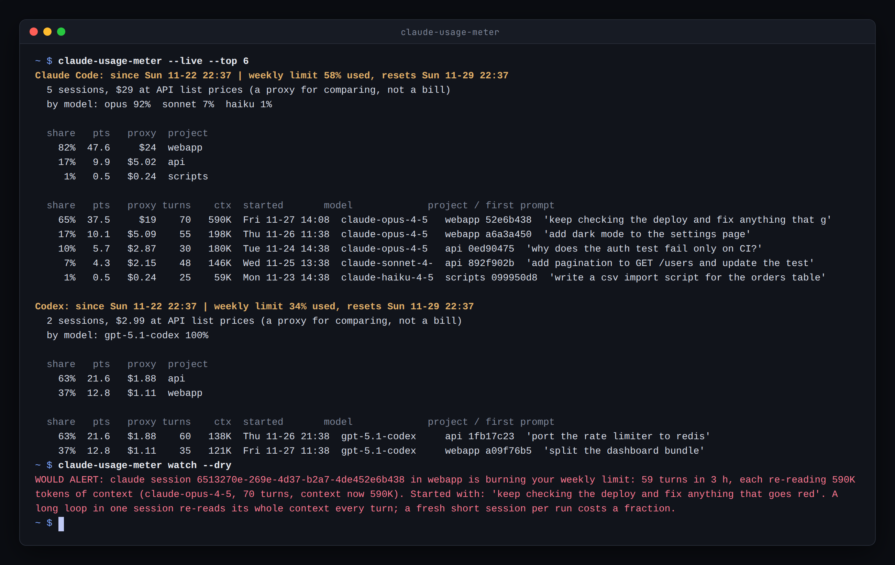

# claude-usage-meter
See which session, project and model used your Claude Code and Codex weekly limit, and get warned when one session is burning the week.



Run on made-up logs (projects webapp, api, scripts).

## Use
```
pipx install git+https://github.com/kilazi/claude-usage-meter
```

```
claude-usage-meter            # this week: share of the limit per project, session and model
claude-usage-meter --live     # also read your Claude weekly % and turn shares into points
claude-usage-meter watch --notify macos   # warn when one session is eating the week (put it in cron)
```

It reads only the local logs in `~/.claude` and `~/.codex`; no model calls, nothing sent anywhere (`--live` makes one call to Anthropic's usage endpoint with your own Claude Code login).
Thresholds, prices and the alert command are flags (`--help`). Needs Python 3.8+.

## Why not ccusage?
ccusage is the go-to cost and token report across Claude Code, Codex, OpenCode, Amp and others. This is not a cost tracker; it answers one question: which session and project ate this week's limit.
It counts from the limit's own reset time, turns each session's share into points of your weekly % (Codex logs carry it, `--live` reads it for Claude), shows how much context each session re-reads per turn, and `watch` warns you while one session is burning the week.
The dollar column is only a weight for comparing sessions, not a bill.

Apache-2.0. Reusing it? Keep the NOTICE: credit kilazi/claude-usage-meter.

More: https://kilazi.com/wiki/claude-usage-meter/ · by kilazi
